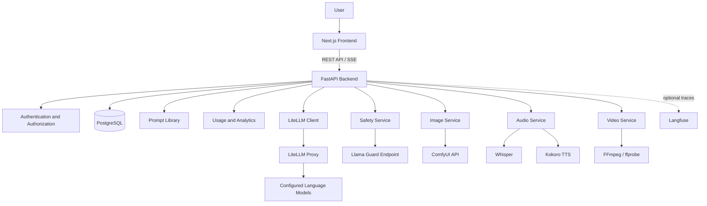

# OmniAI — Multimodal AI Workspace

<p align="center">
  <strong>One workspace for text, image, audio, and video AI workflows.</strong>
</p>

<p align="center">
  <em>A full-stack multimodal AI application built with Next.js, FastAPI, PostgreSQL, LiteLLM, ComfyUI, Whisper, Kokoro, and configurable safety moderation.</em>
</p>

<!-- PROJECT BANNER PLACEHOLDER -->
<p align="center">
  
</p>


---

## Table of Contents

- [Overview](#overview)
- [Project Highlights](#project-highlights)
- [Screenshots](#screenshots)
- [Features](#features)
- [Architecture](#architecture)
- [Technology Stack](#technology-stack)
- [Repository Structure](#repository-structure)
- [Prerequisites](#prerequisites)
- [Local Installation](#local-installation)
- [Environment Configuration](#environment-configuration)
- [Running the Application](#running-the-application)
- [API Overview](#api-overview)
- [Testing and Code Quality](#testing-and-code-quality)
- [Demo Walkthrough](#demo-walkthrough)
- [Troubleshooting](#troubleshooting)
- [Security and Responsible Use](#security-and-responsible-use)
- [Current Scope and Limitations](#current-scope-and-limitations)
- [Future Improvements](#future-improvements)
- [Contributing](#contributing)
- [License](#license)

---

## Overview

**OmniAI** is a unified multimodal AI workspace that brings several AI-powered workflows into one application. Instead of using separate tools for language generation, image creation, speech processing, and video analysis, users can access these capabilities through a single authenticated interface.

The application uses a **Next.js frontend** and a **FastAPI backend**. PostgreSQL stores application data, while dedicated model services handle inference. LiteLLM provides an OpenAI-compatible interface for language-model requests, ComfyUI executes image-generation workflows, Whisper handles speech transcription, and Kokoro provides text-to-speech. Configurable safety moderation, prompt versioning, usage analytics, and optional Langfuse observability support the wider application.

OmniAI is designed as an extensible project: model providers and processing services are integrated behind backend service layers so that provider configuration can evolve without requiring the frontend to communicate directly with each model service.

### Project goals

- Bring multiple AI modalities into one consistent workspace.
- Keep model-provider communication behind the backend API.
- Provide a reusable prompt library with version history.
- Apply safety checks to supported user inputs and generated content.
- Record usage information for per-user analytics.
- Keep the local development and model configuration understandable and reproducible.

---

## Project Highlights

- **Unified workspace:** text, image, audio, and video tools in one frontend.
- **Model gateway:** language-model requests are routed through LiteLLM.
- **Image workflows:** ComfyUI-based image generation with generated-media handling and watermarking.
- **Speech workflows:** audio transcription and text-to-speech.
- **Video processing:** video upload, metadata extraction, audio extraction, and transcription-oriented processing.
- **Safety layer:** configurable moderation using Llama Guard and image safety handling.
- **Prompt management:** save prompts and maintain prompt versions.
- **Usage analytics:** capture request, token, latency, and usage information where available.
- **Observability:** optional Langfuse integration.

---

## Screenshots


### 1. Application dashboard

<!-- Screenshot: dashboard -->


*The main workspace and navigation for the OmniAI application.*

### 2. Text generation workspace

<!-- Screenshot: text workspace -->


*Text generation through the configured LiteLLM model route, including the response experience.*

### 3. Image generation workspace

<!-- Screenshot: image generation -->


*Image generation using the configured ComfyUI workflow.*

### 4. Audio workspace

<!-- Screenshot: audio workspace -->


*Audio transcription and text-to-speech capabilities.*

### 5. Video processing workspace

<!-- Screenshot: video processing -->


*Video upload and processing results, such as extracted metadata and transcript information where available.*

### 6. Prompt Library

<!-- Screenshot: prompt library -->


*Saved prompts and their version history.*


---

## Features

### Text AI

- Text generation through the backend's LiteLLM client.
- OpenAI-compatible chat-completion interface.
- Streaming and non-streaming request paths.
- Configurable model alias and LiteLLM endpoint.
- Configurable safety checks for supported input and output flows.

### Image AI

- Image generation through a ComfyUI API workflow.
- Configurable ComfyUI endpoint and workflow file.
- Generated image storage and retrieval through backend services.
- Image safety status handling.
- Visible AI-generated watermarking in the image workflow.

### Audio AI

- Speech-to-text using the configured Whisper provider.
- Local `faster-whisper` configuration is supported by the backend.
- Text-to-speech using the Kokoro provider.
- Audio task status and generated-file retrieval through the API.

### Video AI

- Video file upload.
- Video metadata extraction.
- Audio extraction using FFmpeg tooling.
- Audio transcription as part of the processing workflow.
- Optional transcript-based summary or caption functionality where configured by the application.

### Prompt Library

- Save and retrieve prompts.
- Update existing prompt records.
- Maintain prompt version history.
- Reuse saved prompts across supported workflows.

### Safety and Governance

- Configurable Llama Guard integration for supported text moderation flows.
- Image safety handling in the image workflow.
- Requests or outputs identified as unsafe can be blocked by configured moderation.
- Acceptable-use and data-handling guidance is documented in [`docs/GOVERNANCE.md`](docs/GOVERNANCE.md).

### Analytics and Observability

- Per-user usage records.
- Request status and latency tracking.
- Token and model usage information where returned by the configured provider.
- Optional Langfuse integration for observability and tracing.

---

## Architecture

OmniAI separates the user interface, application API, persistence, and model-provider integrations.



### Request lifecycle (high level)

1. A user signs in and accesses a workspace in the Next.js application.
2. The frontend sends authenticated requests to the FastAPI API.
3. The backend validates the request and invokes the relevant service.
4. The service communicates with the configured model provider or processing tool.
5. Supported requests pass through configured safety checks.
6. Application records and usage information are persisted in PostgreSQL.
7. The backend returns the result or streams response events to the frontend.

The frontend communicates with the FastAPI backend; it should not contain model-provider secrets or call private model services directly.

---

## Technology Stack

| Layer | Technologies | Responsibility |
|---|---|---|
| Frontend | Next.js, React, TypeScript | Application UI and user workflows |
| UI styling | Tailwind CSS | Responsive interface styling |
| Backend API | Python, FastAPI | REST endpoints, orchestration, validation |
| Database | PostgreSQL, SQLAlchemy, Alembic | Persistence and schema migrations |
| Authentication | JWT, password hashing | User registration, login, protected requests |
| LLM gateway | LiteLLM | Unified language-model interface and routing |
| Text models | Configured LiteLLM providers (for example, Ollama or hosted models) | Text generation |
| Image generation | ComfyUI | Workflow-based image generation |
| Speech-to-text | Whisper / faster-whisper | Audio transcription |
| Text-to-speech | Kokoro | Speech synthesis |
| Video processing | FFmpeg, ffprobe | Media metadata and audio extraction |
| Safety | Llama Guard and image safety services | Configurable content moderation |
| Observability | Langfuse (optional) | Model tracing and observability |
| Testing | pytest, HTTPX | Backend tests and API-level testing |

---

## Repository Structure

```text
OmniAI-main/
├── backend/
│   ├── app/
│   │   ├── api/                 # FastAPI routers and API dependencies
│   │   ├── core/                # Application settings and security
│   │   ├── db/                  # Database session and model metadata
│   │   ├── models/              # SQLAlchemy models
│   │   ├── providers/           # Provider integration package
│   │   ├── repositories/        # Database access layer
│   │   ├── schemas/             # Pydantic schemas and Alembic migrations
│   │   ├── services/            # AI, safety, analytics, and business logic
│   │   └── storage/             # Image, audio, and video storage adapters
│   ├── tests/                   # Backend unit and API tests
│   ├── workflows/               # ComfyUI API workflow definitions
│   ├── .env.example             # Backend environment template
│   ├── alembic.ini              # Migration configuration
│   └── pyproject.toml           # Python dependencies and tooling
├── frontend/
│   ├── src/
│   │   ├── app/                 # Next.js routes and workspace pages
│   │   ├── components/          # Shared UI components
│   │   ├── context/             # Frontend context providers
│   │   └── services/            # Backend API clients
│   ├── .env.example             # Frontend environment template
│   └── package.json             # Node dependencies and scripts
├── docs/
│   ├── screenshots/             # Project screenshots for this README
│   ├── GOVERNANCE.md             # Acceptable use and data handling
│   └── LOCAL_DEMO_CHECKLIST.md  # Local demo verification checklist
├── .env.example                 # Root environment template, if used
└── README.md
```

---

## Prerequisites

The following tools and services are needed for a full local demo. Some are only required for the feature that uses them.

| Requirement | Purpose |
|---|---|
| Python 3.11 or newer | Backend runtime |
| `uv` | Python dependency and virtual-environment management |
| Node.js 20 or newer | Frontend runtime |
| npm | Frontend dependency installation |
| PostgreSQL 15 or newer | Application database |
| FFmpeg and ffprobe | Video metadata and audio processing |
| Ollama (if using local models) | Local language and safety model endpoints |
| LiteLLM Proxy | Language-model gateway |
| ComfyUI | Image-generation workflow execution |

The first audio-model run may download model weights. Allow additional disk space and startup time. CPU inference can be significantly slower than GPU inference.

---

## Local Installation

The following commands use **Windows PowerShell**. Run commands from the repository root unless a step says otherwise.

### 1. Get the project

```powershell
git clone <YOUR_REPOSITORY_URL>
cd OmniAI-main
```

If you already have the project as a ZIP, extract it and open the extracted `OmniAI-main` folder in your terminal or IDE.

### 2. Configure the backend

```powershell
cd backend
Copy-Item .env.example .env
```

Open `backend/.env` and configure the values required by your local setup. At minimum, provide:

- `DATABASE_URL` — PostgreSQL connection string.
- `JWT_SECRET_KEY` — a long, randomly generated secret.
- `LITELLM_BASE_URL` — LiteLLM OpenAI-compatible API base URL.
- `LITELLM_API_KEY` — the key expected by your LiteLLM proxy.
- `LITELLM_DEFAULT_MODEL` — a model alias that exists in your LiteLLM configuration.
- `COMFYUI_BASE_URL` — the reachable ComfyUI API base URL when using ComfyUI image generation.

Install backend dependencies and apply database migrations:

```powershell
uv sync
uv run alembic upgrade head
```

### 3. Configure the frontend

Open a second terminal at the repository root:

```powershell
cd frontend
Copy-Item .env.example .env.local
npm ci
```

The local frontend API variable should point to the FastAPI API root and include `/api/v1`:

```env
NEXT_PUBLIC_API_URL=http://127.0.0.1:8000/api/v1
```

### 4. Configure model and media services

Start and verify only the services needed for the features you intend to demonstrate:

- PostgreSQL for application persistence.
- LiteLLM Proxy and its configured language model provider for text generation.
- Ollama with the configured Llama Guard model if using local safety moderation.
- ComfyUI with the required workflow and custom nodes for image generation.
- Whisper and Kokoro model dependencies for audio workflows.
- FFmpeg and ffprobe for video processing.

For an Ollama-based setup, check the installed models with:

```powershell
ollama list
ollama ps
```

If ComfyUI is running in a temporary cloud notebook or tunnel, its endpoint may change when the session restarts. Update `COMFYUI_BASE_URL` before starting the demo.

### 5. Verify FFmpeg

```powershell
ffmpeg -version
ffprobe -version
```

Both commands should return version information. If PowerShell cannot find them, install FFmpeg and add its `bin` directory to the Windows `PATH`, then open a new terminal.

---

## Environment Configuration

The repository includes environment templates. Copy them to local environment files and replace the example values with your own configuration.

### Backend variables

The main backend configuration is in `backend/.env.example`. Important settings include:

| Variable | Description |
|---|---|
| `DATABASE_URL` | PostgreSQL connection URL used by the application |
| `JWT_SECRET_KEY` | Secret used to sign authentication tokens |
| `LITELLM_BASE_URL` | LiteLLM API base URL |
| `LITELLM_API_KEY` | LiteLLM proxy authentication key |
| `LITELLM_DEFAULT_MODEL` | Configured LiteLLM model alias |
| `IMAGE_BACKEND` | Image provider selection, such as `comfyui` |
| `COMFYUI_BASE_URL` | ComfyUI API endpoint |
| `WHISPER_PROVIDER` | Configured Whisper provider |
| `LOCAL_WHISPER_MODEL` | Local faster-whisper model selection |
| `TTS_PROVIDER` | Text-to-speech provider selection, such as `kokoro` |
| `SAFETY_ENABLED` | Enables or disables configured safety moderation |
| `SAFETY_BASE_URL` | OpenAI-compatible safety-model endpoint |
| `SAFETY_MODEL` | Safety model identifier |
| `LANGFUSE_PUBLIC_KEY` | Optional Langfuse public key |
| `LANGFUSE_SECRET_KEY` | Optional Langfuse secret key |
| `FRONTEND_URL` | Frontend origin allowed by backend CORS |
| `CORS_ORIGINS` | Comma-separated list of additional allowed frontend origins |

### Frontend variables

| Variable | Description | Local example |
|---|---|---|
| `NEXT_PUBLIC_API_URL` | FastAPI base URL used by the browser | `http://127.0.0.1:8000/api/v1` |

> **Important:** Variables prefixed with `NEXT_PUBLIC_` are exposed to the browser. Never place private API keys, database credentials, JWT secrets, or provider tokens in frontend environment variables.

Do not commit `.env`, `.env.local`, API keys, database passwords, private tunnel URLs, or generated media to source control.

---

## Running the Application

Start the backend and frontend in separate terminals.

### Terminal 1 — FastAPI backend

```powershell
cd backend
uv run uvicorn app.main:app --reload --host 127.0.0.1 --port 8000
```

Backend URLs:

- API root: <http://127.0.0.1:8000/>
- Health check: <http://127.0.0.1:8000/health>
- Interactive API documentation: <http://127.0.0.1:8000/docs>
- Alternative API documentation: <http://127.0.0.1:8000/redoc>

### Terminal 2 — Next.js frontend

```powershell
cd frontend
npm run dev
```

Open <http://localhost:3000> in your browser. The root page redirects to the authentication flow. Register a demo user or sign in with an existing account.

### Production build check (optional for local demo)

```powershell
cd frontend
npm run build
```

---

## API Overview

All versioned application routes are mounted under `/api/v1`.

| Area | Base path | Purpose |
|---|---|---|
| Authentication | `/api/v1/auth` | Registration, login, and current-user operations |
| Text AI | `/api/v1/text` | Text generation and streaming |
| Image AI | `/api/v1/images` | Image generation and generated-image retrieval |
| Audio AI | `/api/v1/audio` | Audio upload, transcription, speech generation, and task/file retrieval |
| Video | `/api/v1/video` | Video upload, processing, task status, and file retrieval |
| Prompt Library | `/api/v1/prompts` | Prompt creation, listing, updating, and version history |
| Analytics | `/api/v1/analytics` | Usage and analytics queries |

For the exact request schemas, authentication requirements, response formats, and available operations, run the backend and open the generated Swagger documentation at <http://127.0.0.1:8000/docs>.

---

## Testing and Code Quality

Run backend checks from the `backend/` directory.

### Compile Python modules

```powershell
uv run python -m compileall app
```

### Run backend tests

```powershell
uv run pytest
```

### Inspect migration heads

```powershell
uv run alembic heads
```

Run tests using the test database and environment expected by the test suite. Do not run test migrations against a database containing important data. The frontend also provides these scripts:

```powershell
npm run lint
npm run build
```

A successful compile or build does not replace end-to-end testing of the configured model providers. Verify each real workflow against the services and credentials configured on your machine.

---

## Demo Walkthrough

Use this sequence for a short project demonstration. Test each workflow once before recording so that model downloads, cold starts, and provider connectivity do not interrupt the video.

1. **Introduction:** explain that OmniAI combines multiple AI modalities in one workspace.
2. **Authentication:** register or sign in and open the dashboard.
3. **Text AI:** submit a short prompt and show the generated response or streaming experience.
4. **Image AI:** submit an image prompt, generate an image through ComfyUI, and show the result and watermark.
5. **Audio AI:** demonstrate transcription with a short audio clip and text-to-speech with a short sentence.
6. **Video:** upload a short MP4 containing an audio track and show the available processing output.
7. **Prompt Library:** save a prompt and show it in the library and its version history if available.
8. **Analytics:** show usage records created by the demo requests.
9. **Safety:** demonstrate a safe test request and, if appropriate, a controlled moderation example.

Before recording:

- Confirm that the frontend and backend are both running.
- Confirm all required model endpoints are reachable.
- Warm up slow local models and wait for first-time downloads to finish.
- Use short, pre-tested prompts and small media files.
- Hide browser tabs, terminal output, and desktop notifications that may expose secrets.
- Never show API keys, passwords, database URLs, or private tunnel tokens.
- Use a dedicated demo account and non-sensitive sample media.

For a more detailed checklist, see [`docs/LOCAL_DEMO_CHECKLIST.md`](docs/LOCAL_DEMO_CHECKLIST.md).

---

## Troubleshooting

| Problem | What to check |
|---|---|
| Frontend cannot reach the backend | Check `NEXT_PUBLIC_API_URL`, confirm FastAPI is running on port `8000`, and verify the frontend origin is listed in backend CORS settings. Restart Next.js after changing `.env.local`. |
| Registration or login fails | Check `DATABASE_URL`, database availability, migrations, and `JWT_SECRET_KEY`. Inspect the backend terminal for the actual exception. |
| Text generation fails | Confirm LiteLLM is running, `LITELLM_API_KEY` matches the proxy key, and `LITELLM_DEFAULT_MODEL` matches a model alias in the proxy configuration. |
| Safety moderation fails | Confirm the configured safety endpoint is reachable, the model is available, and `SAFETY_BASE_URL` points to the expected OpenAI-compatible API. |
| Image generation fails | Confirm ComfyUI is running, `COMFYUI_BASE_URL` is current, the workflow JSON is valid for the installed nodes, and the backend can reach the endpoint. |
| Audio processing is slow | Allow model weights to download and warm up. CPU inference may take considerably longer than GPU inference. Check the selected Whisper and Kokoro settings. |
| Video processing fails | Verify `ffmpeg` and `ffprobe` are on `PATH`. Try a short MP4 file with a supported codec and an audio track. |
| Generated media cannot be opened | Check the backend logs, configured storage directories, and whether the processing task completed successfully. |
| Analytics appears empty | Complete one or more successful requests while signed in, then refresh the analytics view. |

When troubleshooting, use the first meaningful exception in the backend or frontend terminal rather than relying only on the final generic error shown in the browser.

---

## Security and Responsible Use

OmniAI is an experimental AI application. Users should not submit highly sensitive personal, financial, medical, or confidential information. Prompts and media may be processed by the model providers configured by the operator.

- Keep provider credentials and database secrets on the backend.
- Use a strong, unique `JWT_SECRET_KEY`.
- Do not expose local Ollama or other private model endpoints directly to the public internet.
- Keep safety moderation enabled when the configured safety service is available and required for the workflow.
- Review generated content before relying on, publishing, or distributing it.
- Follow the project's acceptable-use and data-handling guidance in [`docs/GOVERNANCE.md`](docs/GOVERNANCE.md).

Safety systems can make mistakes and do not guarantee that every unsafe output will be detected. Users remain responsible for evaluating the outputs they generate.

---

## Current Scope and Limitations

The current project scope includes:

- Text generation and streaming through LiteLLM.
- Image generation through the configured ComfyUI workflow.
- Audio transcription and text-to-speech.
- Video upload and processing, including metadata and audio/transcription workflows.
- Prompt management, usage analytics, safety integration, and optional Langfuse observability.

**The current project does not implement text-to-video generation.** The video module is for uploading and processing existing video files; do not present it as a text-to-video generator in the demo.

Actual model availability and performance depend on the provider configuration, hardware, network connectivity, model downloads, and any external service quotas.

---

## Future Improvements

Potential areas for future development, outside the current demo scope, include:

- More provider options and configurable model selection.
- Expanded automated integration and end-to-end test coverage.
- More detailed usage and cost reporting.
- Additional observability and operational monitoring.
- Deployment hardening and persistent media storage for hosted environments.

These are possible next steps, not claims about functionality currently delivered in this repository.

---

## Contributing

Contributions and suggestions are welcome.

1. Fork the repository.
2. Create a focused feature or fix branch.
3. Keep changes scoped and include tests where practical.
4. Run the relevant backend and frontend checks.
5. Open a pull request with a clear description of the change and its verification steps.


---


<p align="center">
  <strong>OmniAI — one workspace, multiple AI workflows.</strong>
</p>
